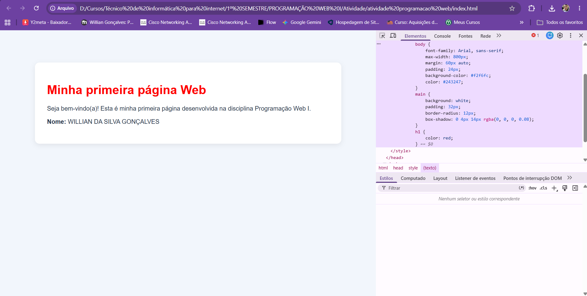

# Minha primeira página Web

**Nome:** Willian da Silva Gonçalves

## Sobre a atividade

Esta é minha primeira página desenvolvida na disciplina Programação Web I. A atividade foi realizada para conhecer o ambiente de desenvolvimento, criar uma página HTML e utilizar as ferramentas de desenvolvedor do navegador.

## Tecnologias utilizadas

- HTML
- Git
- GitHub

## Evidência das DevTools

